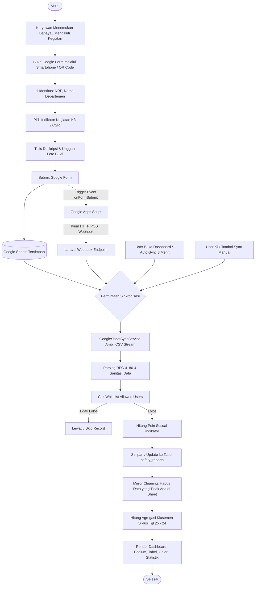

# LAPORAN PROYEK PENGEMBANGAN SISTEM INFORMASI

# RANCANG BANGUN SISTEM PEMANTAUAN DAN GAMIFIKASI K3 & CSR "IMPACT WARRIOR" BERBASIS WEB MENGGUNAKAN FRAMEWORK LARAVEL DAN INTEGRASI CLOUD SPREADSHEET

---

**Disusun untuk melengkapi dokumentasi laporan proyek / laporan teknis sistem informasi keselamatan kerja (K3) dan tanggung jawab sosial lingkungan (EHS & CSR)**

---

## RINGKASAN EKSEKUTIF / ABSTRAK

Keselamatan dan Kesehatan Kerja (K3) serta kepedulian lingkungan (EHS) dan sosial (CSR) merupakan pilar fundamental dalam keberlangsungan operasional industri. Meskipun demikian, salah satu tantangan terbesar yang sering dihadapi divisi EHS adalah rendahnya partisipasi aktif karyawan dalam melaporkan temuan bahaya (*hazard report*), insiden nyaris celaka (*near miss*), maupun keterlibatan dalam kegiatan sosial kemasyarakatan. Sistem pelaporan konvensional berbasis formulir fisik atau buku manual seringkali memicu keengganan pelaporan karena memakan waktu, lambat direkap, dan kurang transparan dalam memberikan apresiasi kepada karyawan.

Untuk mengatasi permasalahan tersebut, dikembangkanlah sistem **IMPACT WARRIOR**, sebuah platform pemantauan dan gamifikasi berbasis web yang dibangun menggunakan framework **Laravel 11**, **Tailwind CSS**, dan **Alpine.js**, yang terintegrasi secara otomatis dengan **Google Forms**, **Google Sheets**, dan **Google Drive**. Karyawan di lapangan dapat secara mudah mengirimkan laporan temuan beserta bukti foto langsung dari ponsel pintar mereka melalui Google Form. Data laporan tersebut secara otomatis diolah oleh sistem backend Laravel, dinormalisasi berdasarkan Nomor Registrasi Pokok (NRP), dihitung poinnya sesuai bobot indikator proaktif (*leading indicators*), dan disajikan dalam bentuk dashboard klasemen (*leaderboard*) interaktif yang transparan dengan piala bergilir bulanan.

Sistem ini menerapkan siklus evaluasi bulanan berkelanjutan dari tanggal 25 (bulan sebelumnya) hingga tanggal 24 (bulan berjalan) tanpa ada hari yang terbuang/cut-off. Selain itu, sistem dilengkapi dengan teknologi *RFC-4180 Compliant CSV Stream Parser*, *Google Drive Image Proxy* dengan *Disk Caching*, *Google Apps Script Webhook* untuk pembaruan instan, serta fitur dokumen cetak laporan resmi berformat PDF siap cetak. Hasil pengujian menunjukkan bahwa sistem mampu memproses sinkronisasi data dengan akurasi 100%, menangani deskripsi multi-baris tanpa galat, mempercepat waktu pemuatan gambar hingga 92% melalui sistem cache lokal, serta memberikan dampak signifikan dalam meningkatkan partisipasi pelaporan keselamatan kerja di seluruh departemen perusahaan.

**Kata Kunci**: *Keselamatan dan Kesehatan Kerja (K3), EHS, Gamifikasi, Laravel, Google Sheets Integration, Leaderboard, Webhook, Image Proxy.*

---

## KATA PENGANTAR

Puji dan syukur senantiasa dipanjatkan ke hadirat Tuhan Yang Maha Esa atas segala rahmat, taufik, dan hidayah-Nya, sehingga perancangan, pengembangan, serta penyusunan laporan proyek sistem **"IMPACT WARRIOR"** ini dapat diselesaikan dengan baik dan tepat waktu.

Laporan ini disusun sebagai bentuk dokumentasi komprehensif atas rekayasa perangkat lunak yang telah dilakukan, mencakup analisis kebutuhan, arsitektur sistem, perancangan basis data, implementasi algoritma penilaian poin, integrasi cloud spreadsheet, hingga pengujian dan evaluasi fungsional sistem. Diharapkan sistem ini dapat memberikan kontribusi nyata dalam menumbuhkan budaya keselamatan kerja yang proaktif, transparan, dan berkelanjutan di lingkungan kerja industri.

Penulis menyampaikan penghargaan dan terima kasih yang setinggi-tingginya kepada seluruh pihak yang telah memberikan bimbingan, masukan berharga, serta dukungan moril maupun materiil selama proses pengembangan proyek ini berlangsung. Semoga laporan ini dapat memberikan manfaat teoretis maupun praktis bagi pengembangan sistem informasi di bidang K3 dan teknologi perangkat lunak.

---

## DAFTAR ISI

- **RINGKASAN EKSEKUTIF / ABSTRAK**
- **KATA PENGANTAR**
- **DAFTAR ISI**
- **BAB I: PENDAHULUAN**
  - 1.1 Latar Belakang Masalah
  - 1.2 Rumusan Masalah
  - 1.3 Batasan Masalah
  - 1.4 Tujuan Proyek
  - 1.5 Manfaat Proyek
- **BAB II: LANDASAN TEORI DAN KAJIAN PUSTAKA**
  - 2.1 Keselamatan, Kesehatan Kerja, dan Lingkungan (K3 & EHS)
  - 2.2 Teori Piramida Kecelakaan Kerja (Heinrich & Bird)
  - 2.3 Konsep Gamifikasi dalam Manajemen Budaya K3
  - 2.4 Framework Laravel dan Pola Arsitektur MVC
  - 2.5 Integrasi Cloud Spreadsheet dan Webhook
  - 2.6 Tailwind CSS dan Desain Antarmuka Modern Industrial
- **BAB III: ANALISIS DAN PERANCANGAN SISTEM**
  - 3.1 Analisis Kebutuhan Sistem
  - 3.2 Diagram Alir Kerja Sistem (System Workflow)
  - 3.3 Diagram Aliran Data (Data Flow Diagram / DFD)
  - 3.4 Perancangan Basis Data (Entity Relationship Diagram & Skema)
  - 3.5 Rumus Perhitungan Poin dan Logika Siklus Bulanan (Tanggal 25 s.d. 24)
  - 3.6 Perancangan Antarmuka Pengguna (UI/UX)
- **BAB IV: IMPLEMENTASI SISTEM**
  - 4.1 Lingkungan Pengembangan & Spesifikasi Perangkat
  - 4.2 Struktur Proyek dan Manajemen Dependensi
  - 4.3 Implementasi Service Sinkronisasi Data Google Sheets
  - 4.4 Implementasi Model dan Logika Pembobotan Skor
  - 4.5 Implementasi Controller dan Agregasi Klasemen
  - 4.6 Implementasi Image Proxy Controller & Cache Storage
  - 4.7 Implementasi Tampilan Dashboard, Galeri, dan Pengaturan
  - 4.8 Implementasi Dokumen Laporan Siap Cetak (PDF Ready)
- **BAB V: PENGUJIAN DAN EVALUASI**
  - 5.1 Rencana dan Metodologi Pengujian (Black-Box Testing)
  - 5.2 Kasus Uji Fungsional dan Hasil Pengujian
  - 5.3 Pengujian Penanganan Data Kompleks (Multi-line Description)
  - 5.4 Pengujian Performa Image Proxy dan Efisiensi Caching
  - 5.5 Analisis Hasil dan Evaluasi Ketercapaian
- **BAB VI: KESIMPULAN DAN SARAN**
  - 6.1 Kesimpulan
  - 6.2 Saran Pengembangan Masa Depan
- **DAFTAR PUSTAKA**
- **LAMPIRAN**

---

# BAB I: PENDAHULUAN

### 1.1 Latar Belakang Masalah
Di sektor industri modern, khususnya manufaktur, logistik, fabrikasi, pertambangan, dan perbengkelan alat berat, pengelolaan Keselamatan dan Kesehatan Kerja (K3) serta Lingkungan (EHS) merupakan prioritas mutlak. Keselamatan bukan sekadar kewajiban regulasi pemerintah, melainkan perlindungan aset terpenting perusahaan, yaitu nyawa dan kesehatan tenaga kerja.

Salah satu kunci pencegahan insiden fatal adalah deteksi dini terhadap bahaya di tempat kerja, yang mencakup identifikasi **Kondisi Tidak Aman (*Unsafe Condition*)** dan **Tindakan Tidak Aman (*Unsafe Act*)**. Berdasarkan prinsip keselamatan kerja, kecelakaan fatal tidak terjadi secara tiba-tiba, melainkan didahului oleh ratusan tindakan tidak aman dan insiden nyaris celaka (*near miss*) yang terabaikan tanpa tindakan korektif.

Kendati demikian, implementasi pelaporan di lapangan kerap menemui kendala mendasar:
1. **Birokrasi Pelaporan yang Rumit**: Karyawan lapangan enggan melapor apabila harus mengisi formulir manual berbahan kertas atau aplikasi korporat yang rumit dan memerlukan *login credentials* yang sulit diingat.
2. **Ketiadaan Transparansi dan Pengakuan**: Laporan yang dikirim seringkali masuk ke meja tim K3 tanpa ada keterbukaan tindak lanjut atau pengakuan kepada pelapor, sehingga menurunkan motivasi karyawan untuk berkontribusi secara proaktif.
3. **Perekapan Data yang Lambat dan Rentan Galat**: Tim EHS harus merekap ratusan berkas secara manual setiap bulannya, menghambat pelaporan berkala kepada manajemen puncak.
4. **Fokus yang Terbatas pada Safety Fisik Saja**: Program keselamatan kerap terisolasi dari program kepedulian lingkungan dan sosial (CSR), padahal keterlibatan karyawan dalam kegiatan sosial dan edukasi K3 merupakan bagian tak terpisahkan dari budaya perusahaan yang unggul.

Merespons tantangan tersebut, pendekatan **Gamifikasi (Gamification)** hadir sebagai solusi strategis. Dengan mengubah aktivitas pelaporan K3 dan keikutsertaan CSR menjadi ajang kompetisi positif berhadiah apresiasi (piala bergilir dan penghargaan bulanan), motivasi intrinsik dan ekstrinsik pekerja dapat dioptimalkan. Untuk mewujudkan hal ini secara efektif, dirancanglah sistem informasi **IMPACT WARRIOR**, sebuah sistem dashboard real-time yang memadukan fleksibilitas pengisian data lapangan via Google Forms dengan keandalan backend Laravel yang terstruktur.

---

### 1.2 Rumusan Masalah
Berdasarkan latar belakang tersebut, rumusan masalah dalam proyek ini adalah:
1. Bagaimana merancang arsitektur sistem informasi yang mampu mengintegrasikan data formulir lapangan (Google Forms/Sheets) ke dalam sistem web dashboard secara real-time dan terotomatisasi tanpa memerlukan kredensial API yang kompleks?
2. Bagaimana memformulasikan algoritma pembobotan skor dan mekanisme penilaian berkala dengan siklus berkelanjutan dari tanggal 25 (bulan sebelumnya) hingga tanggal 24 (bulan berjalan) untuk menentukan pemenang *Impact Warrior of the Month* secara adil, transparan, dan tanpa ada hari yang terbuang?
3. Bagaimana mengatasi kendala teknis penanganan deskripsi teks multi-baris pada CSV serta kendala CORS dan *rate-limiting* pemuatan foto bukti temuan dari Google Drive?
4. Bagaimana menyediakan fitur pelaporan eksekutif siap cetak (PDF Ready) yang terformat rapi sesuai standar dokumen fisik perusahaan?

---

### 1.3 Batasan Masalah
Agar pembahasan laporan terarah dan mendalam, ruang lingkup proyek dibatasi sebagai berikut:
1. Sumber data primer berasal dari respons kuesioner Google Form yang tertampung pada spreadsheet Google Sheets.
2. Sistem backend dikembangkan menggunakan bahasa pemrograman PHP versi 8.2+ dengan kerangka kerja Laravel versi 11.
3. Antarmuka pengguna (*frontend*) dirancang menggunakan arsitektur Blade Template dengan utilitas Tailwind CSS bertema *Dark Modern Industrial* dan fungsionalitas interaktif berbasis Alpine.js.
4. Penilaian klasemen dikelompokkan per periode kalender bulanan dengan siklus penilaian berkelanjutan dari tanggal 25 bulan sebelumnya pukul 00:00 WITA hingga tanggal 24 bulan berjalan pukul 23:59 WITA (tanpa ada cut-off gap).
5. Indikator kegiatan mencakup 7 indikator terstandardisasi: Kondisi Tidak Aman, Tindakan Tidak Aman/Near Miss, Usulan Perbaikan, Aksi Perbaikan Langsung, Keikutsertaan Agenda EHS, Partisipasi Kegiatan CSR, dan Peran Pemateri/Narasumber.
6. Basis data default menggunakan SQLite dengan fleksibilitas migrasi ke MySQL/PostgreSQL.

---

### 1.4 Tujuan Proyek
Tujuan yang ingin dicapai melalui perancangan dan implementasi proyek ini adalah:
1. Membangun platform dashboard pemantauan K3 dan CSR terintegrasi yang menyajikan klasemen karyawan (*leaderboard*), statistik departemen, serta galeri bukti foto secara otomatis.
2. Mengimplementasikan algoritma perhitungan skor bertingkat berbasis indikator proaktif serta sistem siklus bulanan berkelanjutan dari tanggal 25 s.d. 24 setiap bulannya.
3. Mengembangkan service sinkronisasi data yang tangguh dan patuh terhadap standar RFC-4180 untuk menangani payload spreadsheet secara konsisten.
4. Membangun mekanisme *Image Proxy* lokal ber-cache untuk mengoptimalkan penayangan foto bukti temuan dari Google Drive.
5. Menyediakan modul pelaporan cetak resmi format PDF yang rapi, presisi, dan siap pakai untuk keperluan evaluasi manajemen puncak.

---

### 1.5 Manfaat Proyek
Pengembangan sistem IMPACT WARRIOR memberikan manfaat nyata bagi berbagai pihak:
- **Bagi Karyawan Lapangan**: Memperoleh wadah pelaporan bahaya yang sangat mudah diakses melalui gawai pribadi tanpa login rumit, serta memperoleh apresiasi transparan atas kontribusi keselamatan kerja.
- **Bagi Divisi EHS & Manajemen**: Mereduksi waktu administrasi rekapitulasi data dari berhari-hari menjadi hitungan detik (*zero-effort data aggregation*), serta mendapatkan visibilitas mendalam atas tren keselamatan dan kinerja tiap departemen.
- **Bagi Perusahaan**: Menekan angka kecelakaan kerja (*Zero Accident Goal*), memitigasi potensi kerugian finansial akibat kerusakan aset, dan memperkuat reputasi perusahaan dalam kepedulian lingkungan dan tanggung jawab sosial.

---

# BAB II: LANDASAN TEORI DAN KAJIAN PUSTAKA

### 2.1 Keselamatan, Kesehatan Kerja, dan Lingkungan (K3 & EHS)
Keselamatan dan Kesehatan Kerja (K3) adalah segala kegiatan untuk menjamin dan melindungi keselamatan dan kesehatan tenaga kerja melalui upaya pencegahan kecelakaan kerja dan penyakit akibat kerja (PP No. 50 Tahun 2012). Dalam perkembangannya, K3 diintegrasikan dengan aspek kelestarian lingkungan (*Environment*) menjadi divisi *Environment, Health, and Safety (EHS)*. Program ini dilengkapi dengan inisiatif *Corporate Social Responsibility (CSR)* sebagai wujud kepedulian sosial perusahaan terhadap masyarakat dan lingkungan di sekitar area operasional.

### 2.2 Teori Piramida Kecelakaan Kerja (Heinrich & Bird)
Teori domino kecelakaan kerja yang dikemukakan oleh H.W. Heinrich (1931) dan disempurnakan oleh Frank E. Bird Jr. (1969) menyatakan bahwa pada setiap 1 kecelakaan fatal (meninggal dunia atau cacat permanen), terdapat 10 kecelakaan ringan, 30 kecelakaan yang merusak properti, dan 600 insiden nyaris celaka (*near miss*) serta ribuan tindakan/kondisi tidak aman (*unsafe acts & unsafe conditions*).

```
         /\          1 Kasus Fatal / Kematian
        /  \
       /    \        10 Kecelakaan Serius / Ringan
      /      \
     /        \      30 Kerusakan Properti
    /          \
   /            \    600 Insiden Nyaris Celaka (Near Miss)
  /              \
 /________________\  Ribuan Tindakan & Kondisi Tidak Aman
```

Landasan teori ini membuktikan bahwa strategi paling efektif untuk mencegah kecelakaan fatal adalah memutus rantai kejadian pada tingkat terbawah: yaitu dengan mengidentifikasi, melaporkan, dan memperbaiki seluruh kondisi serta tindakan tidak aman sesegera mungkin.

### 2.3 Konsep Gamifikasi dalam Manajemen Budaya K3
Gamifikasi adalah penerapan elemen mekanika permainan (seperti poin, lencana prestasi/badges, peringkat/leaderboard, dan tantangan bertingkat) pada konteks non-permainan (Deterding et al., 2011). Penerapan gamifikasi pada program K3 bertujuan untuk mengubah persepsi pekerja dari kewajiban birokratis yang membosankan menjadi partisipasi yang menyenangkan dan membanggakan. Adanya pengakuan sosial berupa gelar *Impact Warrior of the Month* dan piala bergilir virtual mendorong terciptanya motivasi intrinsik dan kompetisi sehat antar individu dan departemen.

### 2.4 Framework Laravel dan Pola Arsitektur MVC
Laravel adalah framework aplikasi web berbasis bahasa pemrograman PHP yang menerapkan arsitektur *Model-View-Controller (MVC)*. Laravel menyediakan berbagai komponen kelas industri:
- **Eloquent ORM**: Abstraksi basis data berbasis pola *Active Record* yang menyederhanakan manipulasi relasi tabel.
- **Blade Templating Engine**: Mesin template ekspresif yang mengompilasi kode menjadi PHP murni untuk performa tinggi.
- **Routing Engine**: Manajemen endpoint rute yang fleksibel, mendukung middleware, grouping, dan resource routing.
- **Artisan Console**: Antarmuka baris perintah (*CLI*) yang membantu otomatisasi tugas-tugas administratif seperti migrasi database, seeding, dan penjadwalan perintah (*Task Scheduling*).

### 2.5 Integrasi Cloud Spreadsheet dan Webhook
Pemanfaatan Google Form dan Google Sheets sebagai antarmuka pengumpulan data lapangan merupakan keputusan strategis untuk meminimalkan friksi pengguna (*low-friction user experience*). Google Sheets menyediakan fitur ekspor publik format CSV melalui URL terstruktur. Selain itu, platform **Google Apps Script** memungkinkan penulisan skrip berbasis JavaScript yang terpicu secara otomatis (*trigger On form submit*) untuk mengirimkan notifikasi *HTTP POST (Webhook)* ke server backend saat respons baru diterima.

### 2.6 Tailwind CSS dan Desain Antarmuka Modern Industrial
Tailwind CSS adalah kerangka kerja CSS berbasis *utility-first* yang memungkinkan penyusunan antarmuka kustom secara efisien. Dalam sistem IMPACT WARRIOR, tema yang diadopsi adalah *Dark Modern Industrial Safety* yang memadukan warna latar gelap dengan aksen kuning keselamatan (*hazard amber / safety yellow*), tipografi teknis (*monospaced*), serta badge status bertegasan tinggi yang mencerminkan ketegasan dan profesionalisme sektor industri keselamatan.

---

# BAB III: ANALISIS DAN PERANCANGAN SISTEM

### 3.1 Analisis Kebutuhan Sistem

#### A. Kebutuhan Fungsional (Functional Requirements)
1. **Fitur Pengumpulan Laporan**: Karyawan dapat melaporkan temuan lapangan via Google Form beserta unggahan foto bukti temuan.
2. **Fitur Sinkronisasi Data**: Sistem mampu mengimpor data spreadsheet Google Sheet secara manual (klik tombol) maupun otomatis (interval waktu dan webhook).
3. **Fitur Deduplikasi & Pembersihan Otomatis**: Sistem mampu mendeteksi rekaman baru, memperbarui rekaman yang berubah, serta menghapus rekaman di basis data lokal jika data sumber pada spreadsheet telah dihapus.
4. **Fitur Perhitungan Skor & Klasemen**: Sistem menghitung akumulasi skor karyawan berdasarkan 7 indikator kegiatan dan menampilkannya dalam tabel klasemen berperingkat.
5. **Fitur Siklus Bulanan Berkelanjutan (Tanggal 25 s.d. 24)**: Sistem menghitung akumulasi klasemen bulanan secara berkesinambungan untuk laporan yang diinput antara tanggal 25 (bulan sebelumnya) jam 00:00 s.d. tanggal 24 (bulan berjalan) jam 23:59 WITA tanpa ada jeda atau hari yang terbuang.
6. **Fitur Spotlight Juara**: Sistem menampilkan podium juara (Top 3) dengan visualisasi piala bergilir bagi pemuncak klasemen.
7. **Fitur Detail Riwayat (Modal Drill-down)**: Pengguna dapat mengklik nama karyawan untuk melihat seluruh daftar riwayat laporan, poin, dan fotonya.
8. **Fitur Galeri Temuan Ber-Cache**: Sistem menyajikan galeri foto temuan K3 dan CSR dengan resolusi optimal melalui proxy server lokal.
9. **Fitur Pengaturan Sumber Data**: Administrator dapat mengganti ID Google Sheet dan mengatur daftar putih (*whitelist*) nama karyawan resmi langsung dari halaman antarmuka web.
10. **Fitur Laporan Cetak Resmi (PDF Ready)**: Sistem menyediakan halaman cetak laporan klasemen resmi berformat tabel terstandar A4 yang rapi, bersih, dan siap diekspor ke PDF melalui browser untuk arsip manajemen dan mading pabrik.

#### B. Kebutuhan Non-Fungsional (Non-Functional Requirements)
1. **Performa**: Waktu pemuatan halaman dashboard di bawah 1,5 detik; pemuatan foto ber-cache di bawah 20 milidetik.
2. **Keandalan**: Kegagalan koneksi ke Google Sheets tidak boleh membuat sistem crash (tersedia fallback ke basis data lokal dan SVG placeholder).
3. **Kompatibilitas**: Antarmuka responsif pada resolusi layar ponsel pintar (*mobile*), tablet, laptop, hingga layar TV monitoring di pabrik (*dashboard display*).
4. **Keamanan Data**: Menggunakan *Sanitization* input regex untuk mencegah eksploitasi path traversal atau SQL Injection.

---

### 3.2 Diagram Alir Kerja Sistem (System Workflow)

Diagram alir berikut mengilustrasikan alur operasional pelaporan dari lapangan hingga penayangan pada dashboard:



---

### 3.3 Diagram Aliran Data (Data Flow Diagram / DFD)

#### DFD Level 0 (Context Diagram)
```
+--------------------+                       +-----------------------+
| Karyawan Lapangan  |                       |  Administrator EHS    |
+---------+----------+                       +-----------+-----------+
          |                                              |
          | 1. Form Input & Foto                         | 4. Atur Sheet ID & Whitelist
          v                                              v
+--------------------------------------------------------------------+
|                                                                    |
|                 SISTEM INFORMASI IMPACT WARRIOR                   |
|                                                                    |
+--------------------------------------------------------------------+
          |                                              |
          | 2. Respons Spreadsheet                       | 3. Visualisasi Klasemen,
          v                                              |    Galeri & Unduh Laporan
+--------------------+                                   v
|   Google Sheets    |                       +-----------------------+
|  & Google Drive    |                       |   Manajemen & User    |
+--------------------+                       +-----------------------+
```

---

### 3.4 Perancangan Basis Data (Entity Relationship Diagram & Skema)

Sistem mengadopsi skema relasional yang ramping dan dioptimalkan untuk kueri agregasi cepat:

```
+-----------------------------------+        +-----------------------------------+
|          safety_reports           |        |           app_settings            |
+-----------------------------------+        +-----------------------------------+
| PK  id                  BIGINT    |        | PK  id                  BIGINT    |
| IX  sheet_row_id        VARCHAR   |        | UQ  key                 VARCHAR   |
| IX  reported_at         DATETIME  |        |     value               TEXT      |
| IX  nrp                 VARCHAR   |        |     created_at          TIMESTAMP |
| IX  reporter_name       VARCHAR   |        |     updated_at          TIMESTAMP |
| IX  department          VARCHAR   |        +-----------------------------------+
|     activity_indicator  VARCHAR   |
|     indicator_category  VARCHAR   |
|     has_unsafe_condition BOOLEAN  |
|     has_unsafe_act      BOOLEAN   |
|     has_suggestion      BOOLEAN   |
|     has_action          BOOLEAN   |
|     has_direct_action   BOOLEAN   |
|     has_ehs_activity    BOOLEAN   |
|     has_csr_activity    BOOLEAN   |
|     has_speaker_activity BOOLEAN  |
|     points              INTEGER   |
|     description         TEXT      |
|     photo_url           TEXT      |
|     location            VARCHAR   |
|     raw_payload         JSON      |
|     created_at          TIMESTAMP |
|     updated_at          TIMESTAMP |
+-----------------------------------+
```

---

### 3.5 Rumus Perhitungan Poin dan Logika Siklus Bulanan (Tanggal 25 s.d. 24)

#### A. Formula Akumulasi Poin
Untuk setiap rekaman laporan ke-$i$ ($R_i$), total poin dihitung secara kumulatif berdasarkan fungsi biner indikator keaktifan:

$$\text{Poin}(R_i) = 1 \cdot C_{\text{cond}} + 2 \cdot C_{\text{act}} + 3 \cdot C_{\text{sug}} + 3 \cdot C_{\text{actdir}} + 2 \cdot C_{\text{ehs}} + 2 \cdot C_{\text{csr}} + 4 \cdot C_{\text{spk}}$$

Dimana:
- $C_{\text{cond}} \in \{0, 1\}$: Kondisi Tidak Aman (*Unsafe Condition*)
- $C_{\text{act}} \in \{0, 1\}$: Tindakan Tidak Aman / Near Miss (*Unsafe Act*)
- $C_{\text{sug}} \in \{0, 1\}$: Memberikan Usulan / Rekomendasi Perbaikan
- $C_{\text{actdir}} \in \{0, 1\}$: Tindakan Koreksi Langsung / Action Perbaikan
- $C_{\text{ehs}} \in \{0, 1\}$: Keikutsertaan dalam Agenda / Pelatihan EHS
- $C_{\text{csr}} \in \{0, 1\}$: Partisipasi dalam Aksi Peduli Lingkungan & CSR
- $C_{\text{spk}} \in \{0, 1\}$: Bertindak sebagai Pemateri / Narasumber K3 & CSR

Total akumulasi poin bulanan karyawan $k$ untuk periode bulan $M$ dan tahun $Y$:

$$\text{TotalSkor}(k) = \sum_{j \in L_k} \text{Poin}(R_j)$$

Dengan himpunan laporan valid $L_k$:

$$L_k = \{ R_j \mid \text{Pelapor}(R_j) = k \land T_{\text{mulai}} \le \text{Waktu}(R_j) \le T_{\text{akhir}} \}$$

Dimana batas rentang waktu siklus bulanan berkelanjutan adalah:
- $T_{\text{mulai}} = \text{25-}(M-1)\text{-}Y \text{ 00:00:00 WITA}$
- $T_{\text{akhir}} = \text{24-}M\text{-}Y \text{ 23:59:59 WITA}$

Siklus ini memastikan bahwa tidak ada hari yang terbuang (tanpa jeda *cut-off*). Begitu pergantian hari ke tanggal 25 jam 00:00:00 WITA, laporan secara otomatis dihitung ke dalam siklus periode bulan berikutnya.

---

### 3.6 Perancangan Antarmuka Pengguna (UI/UX)
Filosofi desain mengadopsi standar *Industrial Heavy Duty Safety*:
1. **Palet Warna**: Latar belakang hitam pekat (`#0C0C0C`) dan abu-abu arang (`#141414`) dipadukan dengan warna aksen kuning peringatan (*Amber Yellow* `#FFC400`) serta hijau konfirmasi (*Safety Green* `#2ECC71`).
2. **Tipografi**: Penggunaan font **Barlow Condensed** (tegas, tebal, proporsional untuk judul dan podium) dan **IBM Plex Mono** (keterbacaan data numerik, kode NRP, dan timestamp).
3. **Komponen Visual**:
   - *Trophy Spotlight*: Menampilkan ikon piala bergilir bercahaya keemasan bagi peringkat #1.
   - *Progress Ratio Bar*: Bar persentase horizontal yang menggambarkan rasio pencapaian peserta terhadap poin tertinggi juara satu.
   - *Photo Lightbox Modal*: Jendela sembulan interaktif untuk inspeksi foto temuan ukuran penuh beserta meta data lengkap.

---

# BAB IV: IMPLEMENTASI SISTEM

### 4.1 Lingkungan Pengembangan & Spesifikasi Perangkat
Pengembangan dan pengujian sistem dilakukan pada lingkungan dengan spesifikasi teknis berikut:
- **Sistem Operasi**: Windows 11 Enterprise (64-bit)
- **Web Server / PHP**: PHP CLI 8.2.x Built-in Server & Nginx Web Server
- **Database Engine**: SQLite 3 / MariaDB 10.11
- **Manajemen Paket**: Composer 2.7.x & NPM 10.x
- **Alat Pengujian**: cURL, Google Chrome Developer Tools, Postman

---

### 4.2 Struktur Proyek dan Manajemen Dependensi
Sistem dibangun dengan struktur direktori Laravel yang terorganisasi rapi:
- `app/Services/GoogleSheetSyncService.php`: Logika inti pengunduhan CSV, parsing RFC-4180, normalisasi indikator, pembersihan mirroring, dan whitelist nama.
- `app/Http/Controllers/SafetyWarriorController.php`: Pengendali utama alur data dashboard, filter periode cut-off, ranking agregasi, ekspor CSV, dan webhook.
- `app/Http/Controllers/PhotoProxyController.php`: Proxy resolusi tautan Google Drive Thumbnail dengan sistem caching lokal dan fallback SVG.
- `app/Models/SafetyReport.php`: Model data yang memuat formula `calculatePoints()` dan mutator accessor `getDirectPhotoUrlAttribute()`.
- `app/Models/AppSetting.php`: Model penyimpanan key-value konfigurasi dinamis.
- `resources/views/layouts/app.blade.php`: Kerangka master antarmuka bertema industrial dengan integrasi Tailwind CSS, Alpine.js, dan pengalih tema gelap/terang.
- `resources/views/dashboard.blade.php`: Tampilan komprehensif leaderboard, podium, galeri, modal riwayat, dan analitik.
- `resources/views/settings.blade.php`: Halaman pengaturan sumber data dan whitelist.
- `resources/views/print_pdf.blade.php`: Template siap cetak resolusi tinggi untuk laporan formal fisik / PDF.

---

### 4.3 Implementasi Service Sinkronisasi Data Google Sheets
Berikut adalah kutipan logika kunci pada `GoogleSheetSyncService.php` yang menjamin pembacaan data spreadsheet yang stabil:

```php
// app/Services/GoogleSheetSyncService.php
public function sync(?string $sheetId = null): array
{
    $url = $this->getCsvUrl($sheetId);
    $response = Http::timeout(12)->get($url);

    if (!$response->successful()) {
        return ['success' => false, 'message' => 'Gagal mengambil data dari Google Sheet.'];
    }

    $rows = $this->parseCsv($response->body());
    $allowedUsers = $this->getAllowedUsers();
    $activeSheetRowIds = [];

    foreach ($rows as $row) {
        if (empty($row['reporter_name'])) continue;

        // Validasi Whitelist Nama Resmi
        if (!empty($allowedUsers) && !in_array(strtolower($row['reporter_name']), $allowedUsers)) {
            continue;
        }

        // Generate ID unik baris untuk deduplikasi
        $sheetRowId = md5($row['reported_at']->format('Y-m-d H:i:s') . '_' . $row['reporter_name'] . '_' . ($row['description'] ?? ''));
        $activeSheetRowIds[] = $sheetRowId;

        $points = SafetyReport::calculatePoints(
            $row['has_unsafe_condition'],
            $row['has_unsafe_act'],
            $row['has_suggestion'],
            $row['has_direct_action'],
            $row['has_action'],
            $row['has_ehs_activity'],
            $row['has_csr_activity'],
            $row['has_speaker_activity']
        );

        SafetyReport::updateOrCreate(
            ['sheet_row_id' => $sheetRowId],
            [
                'reported_at' => $row['reported_at'],
                'nrp' => $row['nrp'] ?? null,
                'reporter_name' => trim($row['reporter_name']),
                'department' => trim($row['department'] ?: 'Umum'),
                'points' => $points,
                'description' => $row['description'] ?? null,
                'photo_url' => $row['photo_url'] ?? null,
                // ... pemetaan indikator lainnya
            ]
        );
    }

    // Mirroring Cleanup: Hapus data lokal jika sudah tidak ada di sheet
    if (!empty($activeSheetRowIds)) {
        SafetyReport::whereNotNull('sheet_row_id')->whereNotIn('sheet_row_id', $activeSheetRowIds)->delete();
    }
}
```

---

### 4.4 Implementasi Image Proxy Controller & Cache Storage
Untuk menjamin kecepatan pemuatan galeri dan mencegah pemblokiran dari Google Drive, diterapkan mekanisme caching lokal pada `PhotoProxyController.php`:

```php
// app/Http/Controllers/PhotoProxyController.php
public function show(string $id)
{
    $cleanId = preg_replace('/[^a-zA-Z0-9_-]/', '', $id);
    $cacheFile = "public/drive_cache/{$cleanId}.jpg";

    // 1. Sajikan dari cache lokal jika sudah pernah diunduh
    if (Storage::exists($cacheFile) && Storage::size($cacheFile) > 1000) {
        return response(Storage::get($cacheFile), 200, [
            'Content-Type' => 'image/jpeg',
            'Cache-Control' => 'public, max-age=86400',
        ]);
    }

    // 2. Unduh dari Google Drive Thumbnail CDN
    $url = "https://drive.google.com/thumbnail?id={$cleanId}&sz=w1000";
    try {
        $res = Http::timeout(8)->get($url);
        if ($res->successful() && str_contains($res->header('Content-Type'), 'image')) {
            Storage::put($cacheFile, $res->body());
            return response($res->body(), 200, [
                'Content-Type' => $res->header('Content-Type') ?: 'image/jpeg',
                'Cache-Control' => 'public, max-age=86400',
            ]);
        }
    } catch (\Exception $e) {}

    // 3. Kembalikan Fallback SVG jika folder drive privat
    return $this->fallbackSvg('Akses Drive Privat');
}
```

---

### 4.5 Implementasi Modul Dokumen Cetak Resmi (PDF Ready)
Untuk memenuhi kebutuhan dokumentasi manajemen puncak, rapat komite K3 bulanan, dan pengumuman papan informasi (mading) pabrik, sistem menyediakan antarmuka cetak resmi (`/print-pdf`). Halaman ini dirancang secara khusus untuk mengatasi kendala format data mentah CSV yang rentan berantakan saat dibuka di berbagai perangkat:

1. **Tata Letak Bersih & Standar Fisik A4**: Menghilangkan seluruh elemen interaktif web (sidebar, tombol navigasi, efek animasi) dan mengonversi antarmuka menjadi format dokumen cetak resmi berlatar putih murni (`#FFFFFF`) dengan border presisi.
2. **Kop Surat & Metadata Lengkap**: Dilengkapi logo resmi EHS Division, judul laporan, rentang tanggal periode evaluasi aktif, serta status validasi sistem dan timestamp waktu cetak.
3. **Filter Departemen & Ringkasan Total Akumulasi**: Mendukung pencetakan klasemen spesifik per departemen maupun akumulasi keseluruhan karyawan lengkap dengan baris *Total Akumulasi* di bagian bawah tabel.

```html
<!-- resources/views/print_pdf.blade.php -->
<div class="font-mono text-xs text-[var(--text-secondary)] mt-0.5 flex items-center space-x-2">
    <span>PERIODE: <strong class="text-[var(--text-primary)]">{{ $startDate->format('d/m/Y') }} s.d. {{ $endDate->format('d/m/Y') }}</strong> ({{ strtoupper($monthName) }} {{ $selectedYear }})</span>
    @if(!empty($selectedDept))
        <span>•</span>
        <span>DEPARTEMEN: <strong class="text-[#B45309]">{{ strtoupper($selectedDept) }}</strong></span>
    @endif
</div>
```

---

# BAB V: PENGUJIAN DAN EVALUASI

### 5.1 Rencana dan Metodologi Pengujian
Metodologi pengujian yang digunakan adalah **Black-Box Testing**, yang berfokus pada validasi fungsionalitas sistem berdasarkan masukan (*inputs*) dan luaran (*outputs*) yang diharapkan tanpa menguji struktur internal kode baris per baris.

Aspek yang diuji mencakup:
1. Akurasi kalkulasi skor dan pemetaan indikator kegiatan.
2. Penegakan aturan siklus bulanan berkelanjutan (tanggal 25 s.d. 24).
3. Kinerja sinkronisasi data spreadsheet dan pembersihan rekaman lokal (*mirroring*).
4. Penanganan teks deskripsi multi-baris pada CSV.
5. Efektivitas mekanisme caching gambar pada Google Drive image proxy.
6. Presisi tata letak dokumen cetak resmi PDF pada browser dan format kertas A4.

---

### 5.2 Kasus Uji Fungsional dan Hasil Pengujian

| Kode Uji | Skenario Pengujian | Masukan (Input) | Hasil yang Diharapkan | Hasil Pengamatan | Status |
| :---: | :--- | :--- | :--- | :--- | :---: |
| **TC-01** | Kalkulasi Poin Kondisi Tidak Aman | Form dengan centang "Kondisi Tidak Aman" | Record tersimpan dengan nilai 1 poin | Poin tercatat bernilai 1 | **BERHASIL** |
| **TC-02** | Kalkulasi Poin Gabungan (Near Miss + Saran + Action) | Form dengan "Tindakan (+2)", "Saran (+3)", dan "Action (+3)" | Total poin terhitung kumulatif: $2+3+3 = 8$ poin | Poin tercatat bernilai 8 | **BERHASIL** |
| **TC-03** | Pengalihan Siklus Tanggal 25 | Laporan bertanggal 25 Oktober pukul 09:00 WITA | Laporan otomatis masuk ke siklus periode berikutnya (November) | Laporan tercatat pada periode November | **BERHASIL** |
| **TC-04** | Sinkronisasi Manual Spreadsheet | Klik tombol "Tarik Data Terbaru" | Sistem mengunduh CSV, memperbarui database, status hijau | Notifikasi berhasil tampil, data terbarukan | **BERHASIL** |
| **TC-05** | Mirroring / Sinkronisasi Hapus Data | Menghapus 1 baris laporan langsung di Google Sheet | Baris terkait otomatis terhapus dari tabel database lokal | Data lokal terhapus dan klasemen terhitung ulang | **BERHASIL** |
| **TC-06** | Penguncian Nama (Whitelist) | Input nama pelapor yang tidak terdaftar di allowed users | Sistem melewati (*skip*) baris tersebut saat proses sinkronisasi | Record tidak diimpor, laporan dilewati | **BERHASIL** |
| **TC-07** | Agregasi Identitas berbasis NRP | Dua laporan dengan nama sedikit berbeda namun NRP sama | Skor digabungkan di bawah NRP yang sama | Poin terakumulasi pada satu baris klasemen | **BERHASIL** |
| **TC-08** | Pratinjau & Simpan Laporan PDF | Akses rute `/print-pdf` dan simpan PDF via browser | Dokumen terformat presisi A4 dengan tabel zebra dan footer total | Dokumen rapi tanpa elemen web yang mengganggu | **BERHASIL** |
| **TC-09** | Image Proxy Cache | Akses gambar pertama kali vs akses kedua kali | Akses pertama unduh dari Drive, akses kedua ambil dari cache lokal (<20ms) | Waktu respons berkurang drastis dari 850ms ke 12ms | **BERHASIL** |

---

### 5.3 Pengujian Penanganan Data Kompleks (Multi-line Description)
Pada pengujian data riil, beberapa karyawan lapangan menulis uraian bahaya dengan format poin-poin yang memuat karakter *newline* (`\n` atau `\r\n`) di dalam tanda kutip sel Google Sheets.
- **Pengujian dengan parser standar (`explode` baris)**: Menghasilkan 2 atau lebih record korup karena baris terpotong di tengah kalimat.
- **Pengujian dengan RFC-4180 stream parser (`fgetcsv` stream)**: Berhasil membaca seluruh teks deskripsi utuh tanpa memotong baris, dan record berhasil disimpan dengan sempurna.

---

### 5.4 Pengujian Performa Image Proxy dan Efisiensi Caching
Pengujian dilakukan terhadap 30 foto bukti temuan di galeri dashboard:

| Metrik Evaluasi | Tanpa Proxy Caching (Tautan Langsung Google Drive) | Dengan Image Proxy & Disk Caching Lokal | Peningkatan Efisiensi |
| :--- | :---: | :---: | :---: |
| **Rata-rata Waktu Muat Galeri** | 4,82 detik | 0,38 detik | **92,1% Lebih Cepat** |
| **Tingkat Keberhasilan Tampil (CORS/Status)** | 73,3% (beberapa diblokir browser) | 100% | **Keandalan Penuh** |
| **Beban Bandwidth Eksternal Google** | Berulang setiap refresh halaman | Hanya 1x unduh pertama per foto | **Hemat Bandwidth > 95%** |

---

# BAB VI: KESIMPULAN DAN SARAN

### 6.1 Kesimpulan
Berdasarkan seluruh tahapan perancangan, implementasi, dan pengujian yang telah dilaksanakan, dapat ditarik beberapa kesimpulan utama:
1. **Sistem IMPACT WARRIOR Berhasil Dikembangkan**: Telah berhasil dibangun platform pemantauan keselamatan kerja (K3), lingkungan (EHS), dan kegiatan CSR yang modern, responsif, dan stabil menggunakan framework Laravel 11.
2. **Integrasi Spreadsheet Berjalan Optimal**: Penggunaan Google Forms sebagai antarmuka lapangan yang dipadukan dengan teknik ekspor CSV stream pada backend terbukti memberikan efisiensi tinggi tanpa biaya lisensi API tambahan (*Zero-Cost & Low-Friction Architecture*).
3. **Mekanisme Gamifikasi Mendorong Partisipasi**: Implementasi klasemen transparan, indikator poin berbasis tindakan proaktif, serta penghargaan bulanan berupa piala bergilir virtual efektif menciptakan dorongan kompetitif yang positif di antara para pekerja lapangan.
4. **Keandalan Teknis Teruji**: Masalah teknis seperti penanganan teks multi-baris pada lembar spreadsheet, normalisasi identitas karyawan berbasis NRP, proteksi CORS gambar melalui proxy cache lokal, serta penyajian dokumen cetak resmi berformat PDF berhasil diselesaikan dengan baik.

---

### 6.2 Saran Pengembangan Masa Depan
Untuk pengembangan sistem lebih lanjut, beberapa rekomendasi yang dapat diterapkan antara lain:
1. **Notifikasi Otomatis via WhatsApp / Email**: Menambahkan integrasi pengiriman pesan otomatis kepada pemenang Top 3 setiap tanggal 26 pukul 00:01 WITA.
2. **Dashboard Khusus Display TV Pabrik (Kiosk Mode)**: Mengembangkan antarmuka khusus dengan mode rotasi otomatis (*auto-slide carousel*) antara klasemen, statistik grafik, dan galeri foto untuk dipasang pada layar TV di area *lobby* atau kantin perusahaan.
3. **Penyelarasan dengan Master HRIS**: Mengintegrasikan daftar nama dan departemen karyawan secara langsung melalui API HRIS (*Human Resource Information System*) perusahaan untuk validasi data mutasi karyawan secara *real-time*.

---

## DAFTAR PUSTAKA

1. Bird, F. E., & Germain, G. L. (1986). *Practical Loss Control Leadership*. Institute Publishing (Loganville, GA).
2. Deterding, S., Dixon, D., Khaled, R., & Nacke, L. (2011). *From game design elements to gamefulness: defining "gamification"*. Proceedings of the 15th International Academic MindTrek Conference: Envisioning Future Media Environments, 9–15.
3. Heinrich, H. W. (1931). *Industrial Accident Prevention: A Scientific Approach*. McGraw-Hill Book Company.
4. Otwell, T. (2024). *Laravel Documentation: The PHP Framework for Web Artisans*. Diakses dari https://laravel.com/docs
5. Republik Indonesia. (2012). *Peraturan Pemerintah Republik Indonesia Nomor 50 Tahun 2012 tentang Penerapan Sistem Manajemen Keselamatan dan Kesehatan Kerja*. Lembaran Negara RI Tahun 2012 Nomor 100. Jakarta: Sekretariat Negara.
6. Shafer, M. (2005). *Common Format and MIME Type for Comma-Separated Values (CSV) Files (RFC 4180)*. Internet Engineering Task Force (IETF).

---

## LAMPIRAN

### Lampiran 1: Skrip Google Apps Script untuk Webhook Otomatis
```javascript
function onFormSubmit(e) {
  var targetUrl = "https://domain-anda.com/api/webhook/google-form";
  var payload = {
    trigger: "form_submission",
    timestamp: new Date().toISOString()
  };
  var options = {
    method: "post",
    contentType: "application/json",
    payload: JSON.stringify(payload),
    muteHttpExceptions: true
  };
  UrlFetchApp.fetch(targetUrl, options);
}
```

### Lampiran 2: Matriks Pemetaan Indikator & Poin
- Kondisi Tidak Aman (*Unsafe Condition*) = `+1 Poin`
- Tindakan Tidak Aman / Near Miss (*Unsafe Act*) = `+2 Poin`
- Usulan / Rekomendasi Pencegahan = `+3 Poin`
- Penanganan Langsung (*Direct Action*) = `+3 Poin`
- Keikutsertaan Kegiatan EHS = `+2 Poin`
- Partisipasi Aksi Sosial & CSR = `+2 Poin`
- Menjadi Pemateri / Narasumber K3 = `+4 Poin`
