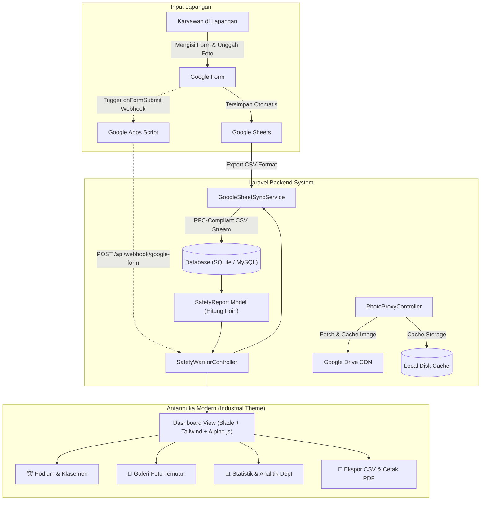

# 🛡️ IMPACT WARRIOR — Dashboard & Sistem Klasemen K3 & CSR

<p align="center">
  <strong>Sistem Monitoring K3, Lingkungan (EHS), dan CSR Terintegrasi Berbasis Gamifikasi Real-Time</strong><br>
  <em>Divisi EHS &middot; Monitoring Partisipasi &middot; Penghargaan Piala Bergilir Bulanan</em>
</p>

---

## 📌 Ringkasan Proyek

**IMPACT WARRIOR** (sebelumnya *Safety Warrior*) adalah platform pemantauan dan gamifikasi keselamatan kerja (K3), kesehatan kerja, pengelolaan lingkungan (EHS), serta kepedulian sosial (CSR). Sistem ini dirancang untuk mendongkrak partisipasi aktif seluruh karyawan dalam melaporkan bahaya di area kerja, mengusulkan ide perbaikan, melakukan penanganan langsung, serta berpartisipasi dalam agenda sosial dan edukasi lingkungan.

Aplikasi ini mengintegrasikan pengumpulan data lapangan dari **Google Form** dan **Google Sheets** secara otomatis ke dalam **Web Dashboard Laravel** modern dengan gaya tampilan *Industrial Safety* (Dark & Light Mode). Setiap kontribusi dihitung menjadi poin berdasarkan indikator kegiatan terstandardisasi, dengan siklus penilaian berkelanjutan tiap tanggal 25 (bulan sebelumnya) hingga 24 (bulan berjalan) tanpa ada jeda/cut-off untuk penobatan gelar juara **"Impact Warrior of the Month"**.

---

## 🌟 Fitur Utama

1. **🏆 Live Leaderboard & Podium Spotlight**
   - Menampilkan peringkat klasemen bulanan karyawan secara real-time.
   - Podium juara untuk Juara 1 (Piala Bergilir Spotlight), Juara 2, dan Juara 3.
   - Perhitungan persentase capaian poin relatif terhadap pemuncak klasemen.
   - Filter berdasarkan bulan, tahun, dan departemen.
   - Pencarian karyawan dan sorting berdasarkan skor tertinggi atau abjad nama.

2. **📅 Siklus Bulanan Berkelanjutan (Tanggal 25 s.d. 24 Tanpa Jeda/Cut-off)**
   - Setiap periode bulanan dinilai dari tanggal 25 (pukul 00:00:00) bulan sebelumnya hingga tanggal 24 (pukul 23:59:59) bulan berjalan secara berkesinambungan tanpa ada hari yang terbuang (tidak ada cut-off gap).
   - Indikator status periode (*Periode Aktif* vs *Arsip Periode*) beserta rentang tanggal transparan pada header dashboard dan dokumen cetak.

3. **📊 Skor & Pembobotan Berjenjang (EHS & CSR Rules)**
   - **Kondisi Tidak Aman (Unsafe Condition)**: `+1 Poin`
   - **Tindakan / Pelaporan Near Miss (Unsafe Act)**: `+2 Poin`
   - **Rekomendasi Perbaikan / Pencegahan (Masukan)**: `+3 Poin`
   - **Penanganan Langsung (Direct Action)**: `+3 Poin`
   - **Mengikuti Kegiatan EHS**: `+2 Poin`
   - **Mengikuti Kegiatan CSR**: `+2 Poin`
   - **Menjadi Narasumber / Pemateri EHS & CSR**: `+4 Poin`

4. **🔄 Sinkronisasi Data Cerdas & Webhook Otomatis**
   - **Sinkronisasi Otomatis**: Dilakukan otomatis saat halaman dibuka jika data berumur > 3 menit.
   - **Tombol Sinkronisasi Manual**: Mengambil data teranyar secara on-demand via Ajax tanpa reload halaman.
   - **Google Form Webhook Endpoint**: Menerima pemicu otomatis via Google Apps Script saat form baru disubmit.
   - **RFC-4180 Compliant CSV Stream Parser**: Membaca catatan deskripsi yang memiliki enter / multi-line tanpa memotong baris atau merusak struktur data.
   - **Database Mirroring & Self-Cleaning**: Menghapus data lokal secara otomatis apabila baris data telah dihapus pada Google Sheet sumber.

5. **🖼️ Galeri Foto Temuan & Image Proxy Google Drive**
   - Menampilkan galeri foto dokumentasi temuan dan aktivitas lapangan.
   - Proxy lokal terdedikasi (`/drive-image/{id}`) untuk mengatasi kendala CORS dan *rate-limit* Google Drive Thumbnail.
   - Sistem *Disk Caching* cerdas: gambar di-cache di storage lokal agar loading instan dan hemat bandwidth.
   - *Fallback SVG*: Menampilkan indikator elegan jika hak akses Google Drive masih bersifat privat.

6. **🔍 Drill-Down Modal Riwayat Temuan Karyawan**
   - Klik nama karyawan pada tabel klasemen untuk membuka modal berisi riwayat lengkap semua laporan, tanggal, jenis temuan, poin, deskripsi, dan foto bukti.

7. **📑 Dokumen & Laporan Cetak Resmi (PDF Ready)**
   - **Halaman Print / Cetak PDF**: Format layout cetak resmi hitam-putih presisi standar industri untuk keperluan arsip laporan manajemen, rapat evaluasi EHS, dan pengumuman mading perusahaan. Dilengkapi filter departemen dan perincian seluruh indikator temuan per karyawan.

8. **🛡️ Whitelist Karyawan & Standarisasi NRP**
   - Fitur whitelist nama resmi pada menu pengaturan untuk mencegah kecurangan atau nama ganda (*typo*).
   - Penggunaan NRP sebagai *Primary Key Identitas* karyawan agar mutasi departemen atau perbedaan spasi nama tidak memecah total poin.

---

## 🏗️ Arsitektur & Teknologi



### Tech Stack
- **Framework**: Laravel 11.x (PHP 8.2+)
- **Database**: SQLite (Bawaan) / MySQL / PostgreSQL
- **Frontend**: Blade Templates, Tailwind CSS (via CDN), Alpine.js
- **Typography & Ikon**: Barlow Condensed, IBM Plex Sans, IBM Plex Mono, Font Awesome 6.5
- **Deployment**: Docker, Fly.io, Vercel

---

## 🚀 Panduan Instalasi & Menjalankan Lokal

### 1. Kebutuhan Sistem
- PHP >= 8.2 (dengan ekstensi `pdo_sqlite`, `curl`, `mbstring`, `fileinfo`)
- Composer >= 2.x
- Git

### 2. Kloning & Pengaturan Dependensi
```bash
# Kloning repositori
git clone <url-repository>
cd SafetyWarrior

# Salin berkas lingkungan (.env)
cp .env.example .env

# Install paket PHP
composer install

# Generate application key
php artisan key:generate
```

### 3. Konfigurasi Database & Storage
```bash
# Jalankan migrasi database
php artisan migrate

# Buat symbolic link ke storage untuk cache foto
php artisan storage:link
```

### 4. Menjalankan Server & Otomasi (Auto-Start Windows)

Aplikasi ini telah dilengkapi sistem **Auto-Start & Background Runner** sehingga dapat berjalan otomatis tanpa harus membuka terminal hitam secara manual:

#### A. Otomatis Berjalan Saat Komputer Menyala (Auto-Start)
- Klik dua kali berkas **`AUTOSTART_ON.bat`** untuk mendaftarkan aplikasi ke folder Startup Windows.
- Setiap kali komputer dinyalakan / login, Web Server (`port 8000`) dan Sinkronisasi Google Sheets otomatis berjalan di latar belakang (tanpa jendela CMD mengganggu).
- Untuk menonaktifkannya kapan saja, cukup klik dua kali **`AUTOSTART_OFF.bat`**.

#### B. Menjalankan / Menghentikan Cepat (Shortcut Batch)
- **`START_APP.bat`** atau **`START_SILENT.vbs`**: Jalankan server & scheduler secara senyap di background dan otomatis buka browser ke `http://127.0.0.1:8000`.
- **`STOP_APP.bat`**: Hentikan seluruh layanan latar belakang Impact Warrior dengan aman.
- **`STATUS_APP.bat`**: Cek status aktif server, port, PID, dan jadwal sinkronisasi otomatis.

#### C. Menjalankan Manual via Terminal
```bash
# Menjalankan web server
php artisan serve

# Menjalankan worker scheduler (sinkronisasi berkala tiap 5 menit)
php artisan schedule:work
```
Buka browser pada alamat: `http://127.0.0.1:8000`

---

## ⚙️ Konfigurasi Google Sheets & Form

1. **Bagikan Google Sheets ke Publik (Pelihat)**:
   - Buka Google Sheets yang menampung respon Google Form.
   - Klik menu **Bagikan (Share)** di pojok kanan atas.
   - Ubah akses umum menjadi: **"Siapa saja yang memiliki link" -> "Pelihat (Viewer)"**.
   - Salin tautan spreadsheet atau salin *Spreadsheet ID* (karakter antara `/d/` dan `/edit`).
2. **Input ID Spreadsheet di Dashboard**:
   - Buka menu **PENGATURAN** di dashboard (`/settings`).
   - Masukkan ID Google Sheet pada kolom yang tersedia dan simpan.
   - Status indikator akan berubah menjadi **HIJAU (TERHUBUNG)**.
3. **Bagikan Folder Google Drive Tempat Foto Diunggah**:
   - Buka folder Google Drive tempat file foto respon form disimpan.
   - Ubah akses folder menjadi **"Siapa saja yang memiliki link: Pelihat"** agar foto dapat dimuat di galeri.

---

## 📁 Struktur Berkas Penting

```
SafetyWarrior/
├── app/
│   ├── Console/Commands/
│   │   └── SyncGoogleSheetCommand.php   # Command artisan CLI untuk sinkronisasi
│   ├── Http/Controllers/
│   │   ├── SafetyWarriorController.php  # Controller utama dashboard, export, webhook
│   │   └── PhotoProxyController.php     # Controller proxy & cache foto Google Drive
│   ├── Models/
│   │   ├── SafetyReport.php             # Model laporan K3 & aturan hitung poin
│   │   └── AppSetting.php               # Key-value store pengaturan sistem
│   └── Services/
│       └── GoogleSheetSyncService.php   # Service parsing CSV & sinkronisasi database
├── database/
│   └── migrations/                      # Skema tabel safety_reports & app_settings
├── resources/
│   └── views/
│       ├── layouts/app.blade.php        # Layout industrial theme (Dark/Light mode)
│       ├── dashboard.blade.php          # Tampilan utama leaderboard & galeri
│       ├── settings.blade.php           # Form konfigurasi ID sheet & whitelist nama
│       └── print_pdf.blade.php          # Layout cetak PDF laporan bulanan
└── routes/
    └── web.php                          # Definisi seluruh rute aplikasi
```

---

## 📜 Lisensi & Hak Cipta
Dikembangkan untuk mendukung budaya keselamatan kerja industri yang proaktif, transparan, dan terukur.
Lisensi: **MIT License**.
